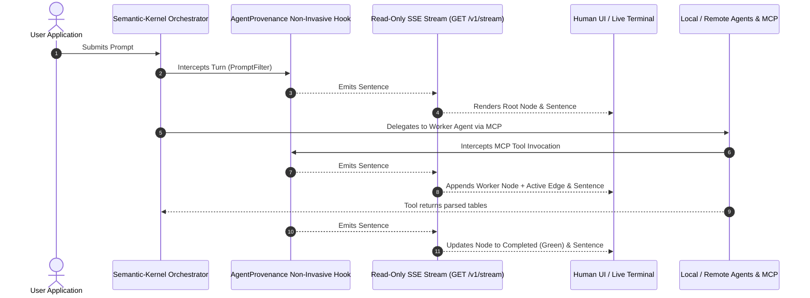
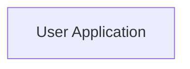
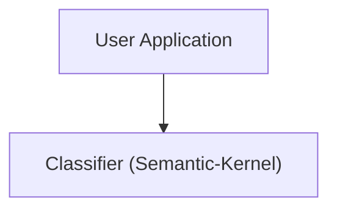
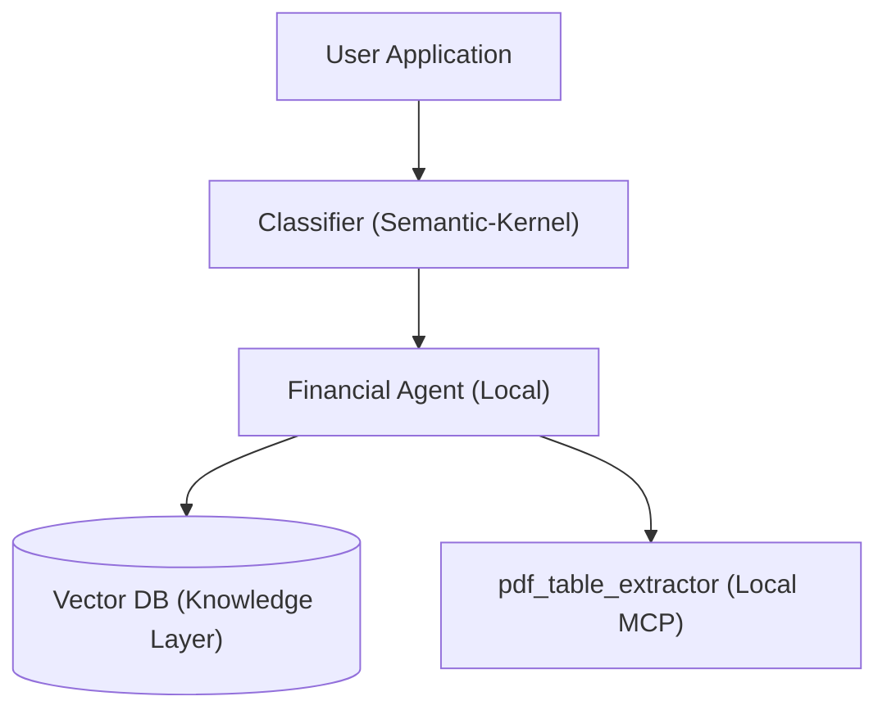
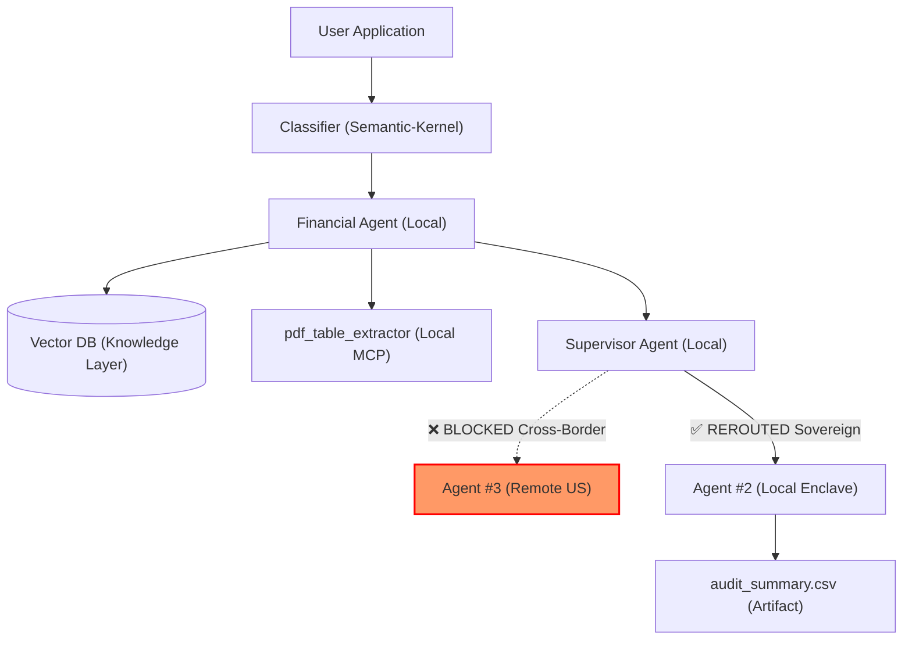

# Non-Invasive Integration Hooks & Minimal Read-Only Live Graph Streaming

---

## 1. Executive Summary

Instead of requiring developers to rewrite multi-agent applications or manually insert tracking calls across thousands of prompts, **AgentProvenance** provides **non-invasive, zero-friction integration hooks** into existing architectures (such as Semantic-Kernel, LangGraph, CrewAI, and MCP).

To monitor the agent fleet without adding compute overhead, write lock contention, or execution latency, AgentProvenance uses a **minimal, read-only Server-Sent Events (SSE) streaming tap**. As agents execute, the system emits:
1. **Live Plain-English Sentences (5-W Layman Stream)** at every micro-step.
2. **Incremental Graph Deltas** that dynamically build and animate the W3C PROV causal DAG node-by-node in real time.



---

## 2. How to Hook into Existing Multi-Agent Architectures (Non-Invasively)

Depending on how the existing architecture is deployed, AgentProvenance offers **3 non-invasive hooking methods** requiring from **0 to 2 lines of code**:

```
┌────────────────────────────────────────────────────────────────────────────────────────┐
│                        3 NON-INVASIVE HOOKING STRATEGIES                               │
├─────────────────────────┬──────────────────────────────┬───────────────────────────────┤
│ Hooking Method          │ Code Changes Required        │ Best For                      │
├─────────────────────────┼──────────────────────────────┼───────────────────────────────┤
│ 1. Transparent Proxy    │ 0 lines (Change Base URL)    │ Any framework, black-box apps │
│ 2. Native Filter / Hook │ 1–2 lines (Register Filter)  │ Semantic-Kernel, LangGraph    │
│ 3. CLI Auto-Instrument │ 0 lines (CLI wrapper command)│ Standard Python/Node scripts  │
└─────────────────────────┴──────────────────────────────┴───────────────────────────────┘
```

---

### Strategy 1: The Transparent Reverse Proxy (Zero Code Changes)
If you cannot or do not want to modify the agent source code at all, AgentProvenance runs as a transparent local proxy:

```
[Semantic-Kernel / Agents] ──> [AgentProvenance Proxy: localhost:8080] ──> [LLM / MCP Server]
                                          │ (Passive Tap)
                                          ▼
                               [W3C PROV Ledger & Live Stream]
```

#### How to Enable:
Simply redirect your environment variables:
```bash
# Redirect OpenAI / Azure OpenAI / Anthropic calls through the local passive tap:
export OPENAI_BASE_URL="http://localhost:8080/v1"
export ANTHROPIC_BASE_URL="http://localhost:8080"

# Redirect MCP Client transports to route through AgentProvenance MCP Proxy:
export MCP_SERVER_URL="http://localhost:8080/mcp"
```
The proxy passively sniffs prompts, tool schemas, and completions in streaming mode without adding latency or modifying payloads.

---

### Strategy 2: Framework-Native Interceptor Filters (1–2 Lines of Code)
In your reference architecture, **Semantic-Kernel** is the Orchestrator, and agents act as **MCP Clients**:

#### A. Semantic-Kernel Native Filter
Semantic-Kernel has a built-in filter pipeline (`FunctionInvocationFilter` and `PromptFilter`). AgentProvenance provides a lightweight pre-built filter:

```python
# In your existing Semantic-Kernel setup file:
from semantic_kernel import Kernel
from agentprovenance.hooks.semantic_kernel import AgentProvenanceFilter

kernel = Kernel()

# ADD THIS SINGLE LINE:
kernel.add_filter("function_invocation", AgentProvenanceFilter())
kernel.add_filter("prompt", AgentProvenanceFilter())

# Your existing agent code runs completely unchanged!
result = await kernel.invoke(...)
```

#### B. Model Context Protocol (MCP) Client Middleware
For Agents #1–#4 communicating via MCP:

```python
from agentprovenance.hooks.mcp import wrap_mcp_client
from mcp import ClientSession

# Wrap your existing MCP ClientSession with a passive read-only audit tap:
client = wrap_mcp_client(existing_mcp_session)

# Calls to tools/call, resources/read, prompts/get are intercepted passively:
result = await client.call_tool("pdf_parser", arguments={"path": "doc.pdf"})
```

---

### Strategy 3: Zero-Code CLI Auto-Instrumentation (`ap-run`)
Using Python runtime patching (similar to OpenTelemetry or `trace-file-lineage`):

```bash
$ ap-run python main_multi_agent_system.py
```
This automatically intercepts:
- `httpx` and `aiohttp` outbound LLM traffic.
- Standard Semantic-Kernel, LangChain, and CrewAI internal dispatcher functions.
- Outbound socket connections to detect **Local-to-Remote cross-border transfers**.

---

## 3. Minimal Read-Only Architecture for Live Output

To view the live progress without disturbing the running multi-agent system, the observer uses an **isolated, read-only Server-Sent Events (SSE) tap**:

```
                                  [Agent Execution Fleet]
                                             │
                              Passive In-Memory Ring Buffer (<5MB)
                                             │
                             GET /v1/stream/{trace_id} (Read-Only)
                                             │
                       ┌─────────────────────┴─────────────────────┐
                       ▼                                           ▼
          [Live 5-W Plain Sentences]                  [Live Incremental Causal DAG]
```

### Why Server-Sent Events (SSE) Over WebSockets?
1. **Strictly Read-Only (Unidirectional)**: Client cannot send commands or mutate agent state over the channel.
2. **Native HTTP GET**: Works through corporate firewalls, API gateways, and proxies with zero custom protocols.
3. **Automatic Reconnection**: Built-in browser reconnection if network drops.
4. **$0 Infrastructure**: Built into standard FastAPI/Starlette with `StreamingResponse`.

### Minimal Streaming Endpoint Implementation
```python
# agentprovenance/api/stream.py
from fastapi import APIRouter
from fastapi.responses import StreamingResponse
import asyncio
import json

router = APIRouter()

@router.get("/v1/stream/{trace_id}")
async def live_trace_stream(trace_id: str):
    """
    Minimal read-only SSE stream.
    Emits two lightweight event types:
      1. 'sentence': 1-line plain-English human summary.
      2. 'graph_delta': New nodes and edges to append to the live diagram.
    """
    async def event_generator():
        queue = await get_or_create_trace_event_queue(trace_id)
        while True:
            # Awaits next intercepted micro-step from agents
            event = await queue.get()
            
            # 1. Emit simple human sentence with explicit Problem Identification
            sentence_payload = {
                "step": event.step_number,
                "timestamp": event.timestamp.isoformat(),
                "sentence": event.layman_summary.summary_line,
                "is_problem_identified": event.layman_summary.is_problem_identified,
                "problem_status": event.layman_summary.problem_status,
                "problem_category": event.layman_summary.problem_category,
                "problem_description": event.layman_summary.problem_description,
                "confidence": event.layman_summary.confidence_score,
                "taint_status": event.security.taint_status
            }
            yield f"event: sentence\ndata: {json.dumps(sentence_payload)}\n\n"
            
            # 2. Emit incremental graph delta
            graph_delta = {
                "step": event.step_number,
                "add_node": {
                    "id": event.activity.activity_id,
                    "label": event.activity.acting_agent,
                    "type": event.activity.activity_type,
                    "status": event.activity.status,
                    "is_problem": event.layman_summary.is_problem_identified
                },
                "add_edge": {
                    "from": event.activity.parent_activity_id,
                    "to": event.activity.activity_id,
                    "relation": "delegated_to"
                } if event.activity.parent_activity_id else None
            }
            yield f"event: graph_delta\ndata: {json.dumps(graph_delta)}\n\n"
            
            if event.is_trace_complete:
                break
                
    return StreamingResponse(event_generator(), media_type="text/event-stream")
```

---

## 4. Live Progress: Simple Sentences + Incremental Graph Construction

Here is how the live output progresses turn-by-turn as an existing multi-agent system runs:

### Live Sentence Feed (With Explicit Problem Identification)
```
[23:38:01 UTC] 🟢 NORMAL (No Problems Identified)
               STEP 1: User Application submitted request: "Analyze financial 10-K report".

[23:38:02 UTC] 🟢 NORMAL (No Problems Identified)
               STEP 2: Classifier routed intent to 'Financial Specialist Agent' (Confidence: 98%).

[23:38:03 UTC] 🟢 NORMAL (No Problems Identified)
               STEP 3: Financial Agent retrieved 3 chunks from 'Knowledge Layer: Vector DB' (Confidence: 94%).

[23:38:05 UTC] 🟢 NORMAL (No Problems Identified)
               STEP 4: Financial Agent called tool 'pdf_table_extractor' via Local MCP Server.

[23:38:08 UTC] 🚨 PROBLEM IDENTIFIED [SOVEREIGNTY_LEAK]
               Issue: Supervisor attempted cross-border delegation of EU financial data to Remote Agent #3 (US Cloud), violating GDPR Article 44.
               Remediation: Automatically blocked and rerouted to Local Agent #2.

[23:38:10 UTC] 🟢 NORMAL (No Problems Identified)
               STEP 6: Local Agent #2 generated artifact 'audit_summary.csv' (Confidence: 99%).
```

### Synchronized Incremental Graph Building

As each sentence arrives, the live UI (or terminal CLI) animates the DAG in real time:

#### At Step 1:


#### At Step 2:


#### At Step 3 & 4:


#### At Step 5 & 6 (Full Causal Lineage with Sovereignty Intercept):


---

## 5. Terminal CLI Live Watcher (`ap watch`)

For developers working in the terminal without a web browser, `ap-cli watch` streams the exact same live sentences and renders an auto-updating ASCII graph:

```bash
$ ap-cli watch --latest

Connecting to read-only SSE stream: http://localhost:8080/v1/stream/tr-latest...
Connected. [Read-Only Monitor Mode]

[23:38:01] • User Application submitted: 'Analyze quarterly report'
[23:38:02] • Classifier routed to Financial-Specialist-Agent
[23:38:03] • Financial-Agent queried Vector DB (Retrieved: 3 chunks)
[23:38:05] • Financial-Agent called MCP tool: pdf_table_extractor
[23:38:08] ⚠️ Sovereignty Policy #2 triggered: Rerouted Remote Agent #3 -> Local Agent #2
[23:38:10] ✓ Local Agent #2 created audit_summary.csv (SHA256: 1a84...)

LIVE CAUSAL GRAPH:
UserApp
 └── Classifier (Semantic-Kernel)
      └── Financial-Agent (Local)
           ├── [Knowledge] Vector DB (3 chunks)
           ├── [MCP Tool] pdf_table_extractor
           └── Supervisor Agent
                ├── ❌ Agent #3 (Remote Cloud) [BLOCKED: Cross-Border Exfiltration]
                └── ✅ Agent #2 (Local Enclave) 
                     └── [Artifact] audit_summary.csv (Signed: Dilithium-5)
```
